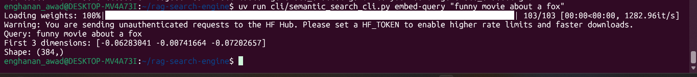
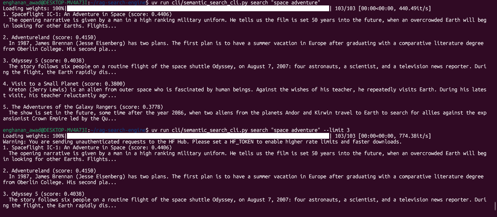
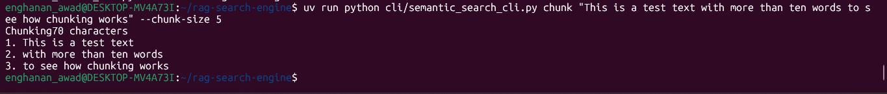
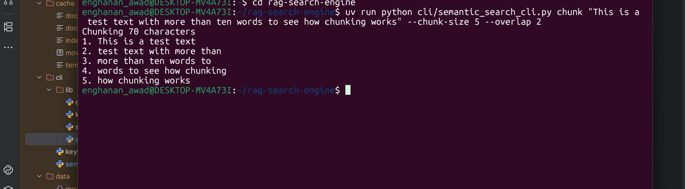
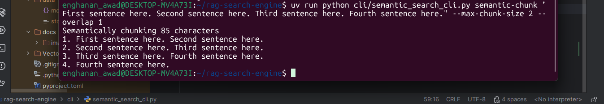
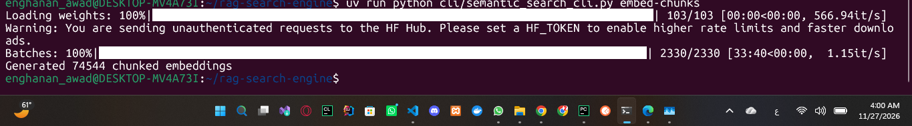
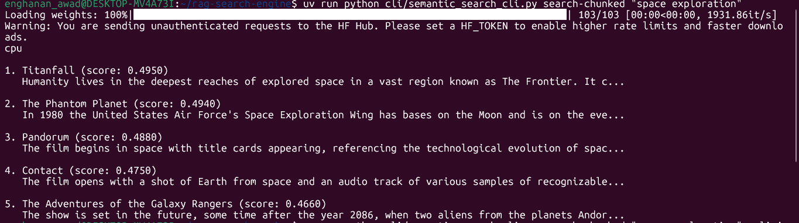

# RAG Search Engine

A movie search engine built with Python that explores information
retrieval techniques, from traditional keyword-based search to semantic
search using embeddings and chunk-based retrieval.

This project is developed step by step while following the **Learn
Retrieval Augmented Generation** course on Boot.dev. Each chapter
introduces concepts and implements them in the search engine.

## Project Overview

The project currently covers:

1.  Text Preprocessing
2.  TF-IDF
3.  Keyword Search and BM25
4.  Semantic Search
5.  Chunking and Chunked Semantic Search

The search engine uses a dataset of 5,000 movies.

------------------------------------------------------------------------

# 1. Text Preprocessing

Text preprocessing prepares raw text before indexing and searching. It
normalizes the text so that words can be matched more consistently.

The preprocessing pipeline includes:

-   **Tokenization:** Splitting text into individual tokens.
-   **Lowercasing:** Converting text to lowercase.
-   **Punctuation removal:** Removing punctuation marks.
-   **Stop-word removal:** Removing common words that provide little
    value for search.
-   **Stemming:** Reducing words to their stem so that related word
    forms can match.

These operations are used by the keyword-search utilities to process
both movie documents and search queries consistently.

------------------------------------------------------------------------

# 2. TF-IDF

TF-IDF stands for **Term Frequency--Inverse Document Frequency**. It
measures how important a term is to a document relative to the entire
collection.

The implementation uses an inverted index to keep track of the documents
containing each term and the frequency of each term in each document.

## 2.1. Term Frequency (TF)

Term Frequency measures how often a term appears in a document.

The project stores term frequencies for each document and provides
`get_tf()` to retrieve the frequency of a term.

## 2.2. Inverse Document Frequency (IDF)

Inverse Document Frequency measures how informative a term is across the
document collection.

A term that appears in many documents is generally less informative than
a term that appears in only a few documents.

The implementation calculates IDF using the number of documents in the
collection and the number of documents containing the term.

## 2.3. TF-IDF Score

The TF-IDF score is calculated by multiplying Term Frequency by Inverse
Document Frequency:

``` python
tf_idf = tf * idf
```

The `get_tfidf()` method combines the two values to calculate the
importance of a term in a specific document.

------------------------------------------------------------------------

# 3. Keyword Search

Keyword search retrieves documents by matching the terms in a query
against terms found in the movie dataset.

## 3.1. Inverted Index

The `InvertedIndex` class builds an inverted index that maps each token
to the set of document IDs containing it.

It also maintains:

-   `index`: Maps tokens to document IDs.
-   `docmap`: Maps document IDs to their movie documents.
-   `term_frequencies`: Stores each term's frequency per document.
-   `doc_lengths`: Stores the number of tokens in each document.

The index is built from each movie's title and description.

## 3.2. Keyword Search

The `keyword_search()` function:

1.  Tokenizes the search query.
2.  Looks up the documents associated with each query token.
3.  Collects matching documents.
4.  Avoids adding the same document more than once.
5.  Returns up to five matching movies.

This approach retrieves documents based on exact processed-term matches.

## 3.3. BM25

BM25 is a ranking function used to score documents according to their
relevance to a query.

The implementation includes:

-   **BM25 IDF:** Calculates the inverse document frequency component.
-   **BM25 TF:** Calculates a term-frequency score with document-length
    normalization.
-   **Document length normalization:** Uses the document length and
    average document length.
-   **BM25 Search:** Calculates a score for each document by summing the
    BM25 scores of the query terms, then sorts the results by score.

The implementation uses the configurable constants `BM25_K1` and
`BM25_B`.

## 3.4. Saving and Loading the Index

The inverted index data is cached using Python pickle files:

-   `cache/index.pkl`
-   `cache/docmap.pkl`
-   `cache/term_frequencies.pkl`
-   `cache/doc_lengths.pkl`

This allows the application to load the built index instead of
rebuilding it for every search.

## 3.5. Keyword Search CLI

The keyword search CLI provides commands for building the index,
searching, and inspecting TF, IDF, TF-IDF, and BM25 values.

  Command        Description
  -------------- ------------------------------------------------------
  `build`        Build and save the inverted index.
  `search`       Search for movies using query keywords.
  `tf`           Get the term frequency for a document and term.
  `idf`          Calculate the IDF score for a term.
  `tfidf`        Calculate the TF-IDF score for a document and term.
  `bm25idf`      Calculate the BM25 IDF score for a term.
  `bm25tf`       Calculate the BM25 TF score for a document and term.
  `bm25search`   Search and rank movies using BM25.

Example usage:

``` bash
# Build the inverted index
uv run python cli/keyword_search_cli.py build

# Search by keywords
uv run python cli/keyword_search_cli.py search "space adventure"

# Calculate TF-IDF
uv run python cli/keyword_search_cli.py tfidf 1 "space"

# Search using BM25
uv run python cli/keyword_search_cli.py bm25search "space adventure" --limit 5
```

------------------------------------------------------------------------

# 4. Semantic Search

Semantic search retrieves documents based on meaning rather than relying
only on exact keyword matches.

It represents text as numerical vectors called **embeddings** and
compares those vectors to find semantically related content.

## 4.1. Embedding Model

The project uses the `all-MiniLM-L6-v2` model from Sentence Transformers
to generate embeddings.

``` python
from sentence_transformers import SentenceTransformer

model = SentenceTransformer("all-MiniLM-L6-v2")
```

Each embedding contains 384 dimensions.

### Verify the Embedding Model

The `verify` command checks that the embedding model loads correctly and
displays its maximum sequence length.


## 4.2. Generating Text Embeddings

The `generate_embedding()` method converts an input string into an
embedding vector.

``` python
embedding = self.model.encode([text])[0]
```

The method also validates the input and raises a `ValueError` if the
text is empty or contains only whitespace.


## 4.3. Generating Movie Embeddings

The `build_embeddings()` method generates embeddings for the movie
dataset.

For each movie, the title and description are combined before being
passed to the model:

``` python
texts = [
    f"{doc['title']}: {doc['description']}"
    for doc in documents
]

self.embeddings = self.model.encode(
    texts,
    show_progress_bar=True
)
```

The resulting vectors represent the semantic content of the movies.


## 4.4. Saving and Loading Embeddings

Generating embeddings for the full dataset takes time, so the project
caches them using NumPy.

``` python
np.save("cache/movie_embeddings.npy", self.embeddings)
```

The `load_or_create_embeddings()` method:

-   Loads the cached embeddings if the file exists and its number of
    vectors matches the number of documents.
-   Otherwise, generates new embeddings and saves them.

The dataset contains 5,000 movies, represented by 5,000 vectors with 384
dimensions each.


## 4.5. Query Embeddings

A search query must also be converted into an embedding before it can be
compared with movie embeddings.

The `embed-query` command uses `generate_embedding()` to create a query
vector. A query embedding has a shape of `(384,)`.



## 4.6. Vector Operations and Cosine Similarity

Cosine similarity measures the angle between two vectors and is used to
estimate how similar their directions are.

The project implements `cosine_similarity()` with NumPy:

``` python
dot_product = np.dot(vec1, vec2)
norm1 = np.linalg.norm(vec1)
norm2 = np.linalg.norm(vec2)

if norm1 == 0 or norm2 == 0:
    return 0.0

return dot_product / (norm1 * norm2)
```

A higher cosine similarity score indicates that two vectors are more
similar in direction.

## 4.7. Semantic Search Implementation

The `search()` method retrieves movies based on their semantic
similarity to a query.

The search process:

1.  Checks that movie embeddings are loaded.
2.  Generates an embedding for the query.
3.  Calculates cosine similarity between the query vector and each movie
    vector.
4.  Associates each similarity score with its movie document.
5.  Sorts the results by score in descending order.
6.  Returns the top results according to the requested limit.

Each result contains the movie title, description, and similarity score.



## 4.8. Semantic Search CLI

The semantic search CLI provides commands for verifying the model,
generating embeddings, and searching movies.

  -----------------------------------------------------------------------
  Command                             Description
  ----------------------------------- -----------------------------------
  `verify`                            Verify that the embedding model
                                      loads correctly.

  `embed-text`                        Generate an embedding for a text
                                      input.

  `verify-embeddings`                 Load or generate movie embeddings
                                      and display their dimensions.

  `embed-query`                       Generate an embedding for a search
                                      query.

  `search`                            Search movies using semantic
                                      similarity.
  -----------------------------------------------------------------------

Example usage:

``` bash
# Verify the model
uv run python cli/semantic_search_cli.py verify

# Generate a text embedding
uv run python cli/semantic_search_cli.py embed-text "A movie about a clever fox"

# Generate or load movie embeddings
uv run python cli/semantic_search_cli.py verify-embeddings

# Generate a query embedding
uv run python cli/semantic_search_cli.py embed-query "funny movie about a fox"

# Search for movies
uv run python cli/semantic_search_cli.py search "space adventure"

# Limit the number of results
uv run python cli/semantic_search_cli.py search "space adventure" --limit 3
```

------------------------------------------------------------------------

# 5. Chunking

Chunking divides a long document into smaller pieces so that each piece
can be embedded and searched separately.

Instead of representing an entire movie description with one embedding,
chunked semantic search creates embeddings for smaller sections of the
description.

## 5.1. Fixed-Size Chunking

Fixed-size chunking divides text into chunks based on a specified number
of words.

The `chunk_text()` function accepts:

-   `chunk_size`: The maximum number of words in each chunk.
-   `overlap`: The number of words shared between consecutive chunks.

Overlap helps preserve context around chunk boundaries.



## 5.2. Chunk Overlap

With overlap, the end of one chunk is repeated at the beginning of the
next chunk.

For example, with a chunk size of 5 words and an overlap of 2 words, the
next chunk starts with the final two words of the previous chunk.

This reduces the chance of losing useful context when information spans
a chunk boundary.



## 5.3. Semantic Chunking

Semantic chunking divides text based on sentence boundaries rather than
a fixed number of words.

The `semantic_chunk_text()` function uses a regular expression to split
the input after sentence-ending punctuation (`.`, `!`, or `?`), then
groups sentences according to `max_chunk_size`.

It also supports overlap between consecutive chunks.



## 5.4. Semantic Chunking Edge Cases

The semantic chunking implementation handles several edge cases:

-   Removes leading and trailing whitespace before splitting.
-   Returns an empty list when the input is empty or contains only
    whitespace.
-   Keeps a sentence without ending punctuation as a chunk.
-   Strips whitespace from individual sentences.
-   Adds only non-empty chunks to the result.


## 5.5. Generating Chunk Embeddings

The `ChunkedSemanticSearch` class extends `SemanticSearch` and adds
support for chunk embeddings.

The `build_chunk_embeddings()` method:

1.  Iterates over the movie documents.
2.  Skips descriptions that are empty or contain only whitespace.
3.  Splits each description into semantic chunks using a maximum of four
    sentences and an overlap of one sentence.
4.  Collects all chunks.
5.  Generates an embedding for each chunk using the same Sentence
    Transformers model.
6.  Stores metadata for every chunk.

Each chunk's metadata contains:

-   `movie_idx`: The index of the movie in the documents list.
-   `chunk_idx`: The chunk's position within that movie.
-   `total_chunks`: The total number of chunks created for that movie.

The chunk embeddings are saved in `cache/chunk_embeddings.npy`, while
their metadata is saved in `cache/chunk_metadata.json`.



## 5.6. Loading Cached Chunk Embeddings

The `load_or_create_chunk_embeddings()` method checks whether both the
chunk embeddings and metadata cache files exist.

-   If both files exist, it loads the embeddings and metadata.
-   Otherwise, it builds the chunk embeddings and saves both files.

This avoids generating the chunk embeddings again on every run.

## 5.7. Chunked Semantic Search

The `search_chunks()` method compares a query embedding against all
chunk embeddings.

The search process:

1.  Generates an embedding for the query.
2.  Calculates cosine similarity between the query and every chunk
    embedding.
3.  Associates each score with its movie index and chunk index.
4.  Keeps the highest-scoring chunk score for each movie.
5.  Sorts the movies by their best chunk score.
6.  Returns the top matching movies.

Keeping the best score per movie ensures that a movie is returned only
once, even if several of its chunks are highly relevant.



The CLI also supports limiting the number of returned results:


## 5.8. Chunking CLI

The chunking commands are available through `semantic_search_cli.py`.

  Command            Description
  ------------------ -----------------------------------------------
  `chunk`            Split text into fixed-size word chunks.
  `semantic-chunk`   Split text into sentence-based chunks.
  `embed-chunks`     Generate or load embeddings for movie chunks.
  `search-chunked`   Search movies using chunk embeddings.

Example usage:

``` bash
# Fixed-size chunking
uv run python cli/semantic_search_cli.py chunk "A sample text for chunking" --chunk-size 5 --overlap 2

# Semantic chunking
uv run python cli/semantic_search_cli.py semantic-chunk "First sentence. Second sentence. Third sentence." --max-chunk-size 2 --overlap 1

# Generate or load chunk embeddings
uv run python cli/semantic_search_cli.py embed-chunks

# Search using chunk embeddings
uv run python cli/semantic_search_cli.py search-chunked "space exploration"

# Limit the number of results
uv run python cli/semantic_search_cli.py search-chunked "space exploration" --limit 3
```

------------------------------------------------------------------------

## Technologies Used

-   Python
-   NumPy
-   Sentence Transformers
-   `all-MiniLM-L6-v2`
-   NLTK
-   uv
-   JSON
-   Pickle
