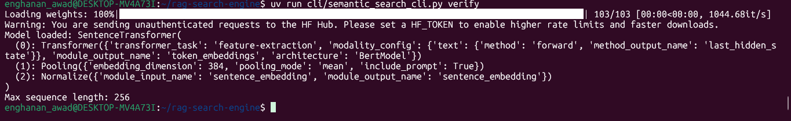

# RAG Search Engine

A movie search engine built with Python that explores different information retrieval techniques, starting with traditional keyword-based search and progressing to semantic search using embeddings.

This project is developed step by step, implementing the concepts and techniques covered throughout the course.

## Project Overview

The project explores different approaches to searching and retrieving relevant movie information:

- **Text Preprocessing:** Preparing text to improve keyword matching.
- **TF-IDF:** Ranking documents based on the importance of query terms.
- **Keyword Search:** Finding documents based on matching words.
- **Semantic Search:** Finding relevant movies based on meaning rather than exact keyword matches.

---

## 1. Text Preprocessing

Applied text preprocessing techniques to normalize text and improve keyword matching.

These techniques include:

- Tokenization
- Punctuation removal
- Stop-word removal
- Stemming

## 2. TF-IDF

Implemented TF-IDF (Term Frequency–Inverse Document Frequency) to measure the importance of a term within a document relative to the entire dataset.

This helps rank search results based on term importance rather than simply counting matching words.

## 3. Keyword Search

Implemented a keyword-based search system that retrieves movies by matching query terms against document content.

---

# 4. Semantic Search

Semantic search retrieves documents based on their meaning and context, even when the query does not contain the exact words used in the document.

Unlike keyword search, which relies on matching terms, semantic search uses embedding models to represent text as numerical vectors.

## 4.1. Embedding Model

Used the `all-MiniLM-L6-v2` model from Sentence Transformers to convert text into numerical representations called embeddings.

The model is initialized using:

```python
from sentence_transformers import SentenceTransformer

model = SentenceTransformer("all-MiniLM-L6-v2")
```

The model was selected for its ability to generate meaningful sentence embeddings while remaining relatively lightweight and efficient.

Each generated embedding contains 384 dimensions.

### Verify the Embedding Model

The `verify` command checks that the embedding model loads correctly.



## 4.2. Generating Text Embeddings

Implemented `generate_embedding()` to convert a given text into an embedding vector.

```python
embedding = self.model.encode([text])[0]
```

The method also validates the input to prevent generating embeddings for empty text.


## 4.3. Generating Movie Embeddings

Implemented `build_embeddings()` to generate embeddings for the entire movie dataset.

For each movie, the title and description are combined before generating its embedding:

```python
texts = [
    f"{doc['title']}: {doc['description']}"
    for doc in documents
]

self.embeddings = self.model.encode(
    texts,
    show_progress_bar=True
)
```

The generated embeddings represent the semantic content of the movies and are used later to perform similarity searches.


## 4.4. Saving and Loading Embeddings

Generating embeddings for the entire dataset is computationally expensive, so the results are saved to disk using NumPy.

```python
np.save("cache/movie_embeddings.npy", self.embeddings)
```

Implemented `load_or_create_embeddings()` to reuse previously generated embeddings.

The method checks whether a cached file exists:

- If the cache exists and its number of vectors matches the number of documents, the existing embeddings are loaded.
- Otherwise, new embeddings are generated and saved.

This avoids repeating the embedding generation process every time the application runs.

The dataset contains 5,000 movies, represented by 5,000 embedding vectors, each with 384 dimensions.


## 4.5. Query Embeddings

Search queries must also be converted into embeddings before they can be compared with movie embeddings.

Implemented `embed_query_text()` using the existing `generate_embedding()` method.

A single query produces a one-dimensional vector with a shape of `(384,)`, representing its 384 dimensions.


## 4.6. Vector Operations

Vector operations are used to compare and measure relationships between embeddings.

### Dot Product

The dot product multiplies corresponding elements of two vectors and sums the results.

It is one of the basic operations used in vector similarity calculations.

### Cosine Similarity

Implemented `cosine_similarity()` using NumPy to measure the similarity between two vectors.

Cosine similarity measures the cosine of the angle between two vectors:

```python
dot_product = np.dot(vec1, vec2)
norm1 = np.linalg.norm(vec1)
norm2 = np.linalg.norm(vec2)

if norm1 == 0 or norm2 == 0:
    return 0.0

return dot_product / (norm1 * norm2)
```

A higher cosine similarity score indicates that the two vectors point in a more similar direction.

## 4.7. Semantic Search Implementation

Implemented the `search()` method to retrieve movies based on their semantic similarity to a query.

The search process:

1. Checks whether movie embeddings are loaded.
2. Generates an embedding for the search query.
3. Calculates cosine similarity between the query embedding and each movie embedding.
4. Stores similarity scores alongside their corresponding documents.
5. Sorts the results in descending order based on similarity scores.
6. Returns the top results according to the requested limit.

Each result contains:

- `score`: The cosine similarity score.
- `title`: The movie title.
- `description`: The movie description.


## 4.8. Locality-Sensitive Hashing (LSH)

Locality-Sensitive Hashing (LSH) is a technique used to speed up similarity searches in large datasets.

Instead of comparing a query against every vector, LSH groups similar vectors into buckets using special hash functions.

During a search, only vectors in the relevant bucket are considered.

LSH provides a trade-off between search speed and recall. It can reduce the number of comparisons, but may miss some relevant results.

It is useful when search speed is more important than retrieving every possible similar result.

## 4.9. Command-Line Interface

Added CLI commands to interact with the semantic search functionality.

| Command | Description |
|---|---|
| `verify` | Verify that the embedding model loads correctly. |
| `embed-text` | Generate an embedding for a given text. |
| `verify-embeddings` | Generate or load movie embeddings and verify their dimensions. |
| `embed-query` | Generate an embedding for a search query. |
| `search` | Search for movies using semantic similarity. |

### Example Usage

```bash
# Verify the model
uv run cli/semantic_search_cli.py verify

# Generate a text embedding
uv run cli/semantic_search_cli.py embed-text "A movie about a clever fox"

# Generate or load movie embeddings
uv run cli/semantic_search_cli.py verify-embeddings

# Generate a query embedding
uv run cli/semantic_search_cli.py embed-query "funny movie about a fox"

# Search for movies
uv run cli/semantic_search_cli.py search "space adventure"

# Limit the number of results
uv run cli/semantic_search_cli.py search "space adventure" --limit 3
```


## Technologies Used

- Python
- NumPy
- Sentence Transformers
- `all-MiniLM-L6-v2`
- uv
